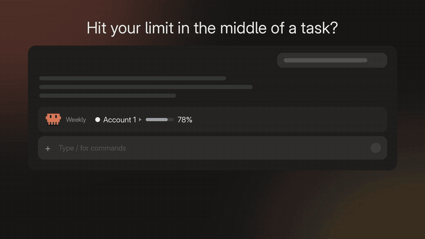
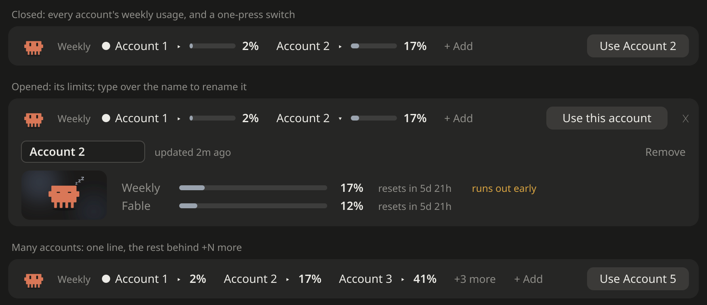
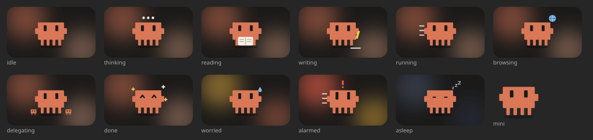

# claude-hats

**One Claude, many hats.** Use several Claude subscriptions in one Claude Code. Each account is a hat: a row above the prompt shows how much of each one's limits is used, and one press changes which hat your requests go out under. It is still one app, one `~/.claude` folder, the same skills, settings and sessions. Only the account behind each request changes.

[](docs/promo.mp4)

*A 30-second tour. [Watch it with sound](docs/promo.mp4).*



*An illustration drawn with the plugin's own graphics.*

## What it does

- **Usage for every account, always in view.** A row above the prompt shows each account's weekly usage. Press an account to open its 5-hour, weekly and Fable limits, with the time each one resets and a warning when it would run out before then.
- **One-press switching.** `Use this account` sends your next message from that account. No logging out, no second window, no restart. The quick button on the row recommends the account with the most room left: the one whose fullest limit (5-hour, weekly or Fable) is lowest.
- **Any number of accounts.** Add, rename and remove them right in the row. The row stays on one line however many you have.
- **No other tool needed.** The figures come from the rate-limit headers on Claude's own responses, so nothing extra is installed and no extra request is made.
- **A small companion.** A character on the row acts out what Claude is doing (thinking, reading, writing, running a command, looking something up, working with helpers) and gets uneasy as the account in use runs low.



## Install

In a terminal session of Claude Code, at the prompt:

```
/plugin install hats --marketplace Akramovic1/claude-hats
```

Or from a shell:

```
claude plugin install hats --marketplace Akramovic1/claude-hats
```

In the desktop app, where `/plugin` does not run: click **+** next to the prompt box, then **Plugins**, **Add marketplace** with `Akramovic1/claude-hats`, then **Add plugin** (it is listed as `hats`).

The plugin inside this repository is named `hats`, because Claude Code keeps plugin names that start with `claude-` for Anthropic's own.

It is written to run on macOS, Linux and Windows, and has been tested on Linux so far. Adding an account uses a small bash script, so on Windows run that step in Git Bash or WSL.

Needs Claude Code 2.1.325 or newer.

## Add an account

The account your Claude Code is signed in to is there from the start. For each other subscription:

1. Press **+ Add** on the row, type a name and press Enter. (Or: `/accounts-add Work`.)
2. The new account's card opens and shows one command. Run it in a terminal, with your browser signed in to claude.ai as that account:

   ```
   bash "<plugin folder>/bin/save-token" <account id>
   ```

   It runs `claude setup-token` for you, picks the new token up by itself (nothing to copy or paste), checks that Anthropic accepts it, and saves it where only you can read it.
3. Back in Claude, the account shows as ready within a few seconds. Press it on the row, then **Use this account**.

Run it in a normal terminal, not inside a Claude chat (not with `!`), so the token never ends up in a transcript.

An added account shows no email by default: the token that `claude setup-token` issues is not allowed to read the account's profile. To show one beside the name, add `--email you@example.com` to the command. If the automatic pickup fails, the command asks you to paste the token instead; `--paste` goes straight to that.

## Everyday use

| You want to | Do this |
| --- | --- |
| See one account's limits | Press its name on the row |
| Switch to the account with the most room | Press `Use <account>` at the right of the row |
| Switch to a specific account | Open it, then `Use this account` |
| Rename an account | Open it, **Rename**, type the name, Enter. Or `/accounts-rename 2 = Work` |
| Remove an account | Open it, **Remove**, then **Confirm remove**. Or `/accounts-remove Work` |
| Add an account | **+ Add** on the row |
| See every account at once | `/accounts` |

The switch applies to every session of the app, from the next message on. If an account's token is refused (revoked, or expired after a year), Claude goes back to its own account and tells you.

## How it works

Every request Claude Code sends to the model passes through this plugin's `http.fetch` hook. While another account is chosen, the hook replaces the request's `Authorization` header with that account's token. Only requests to the Messages API on `https://api.anthropic.com` are touched: if Claude Code is pointed at another base URL (a gateway, a proxy, a cloud provider), nothing is rerouted, so a token never travels to another host. Sign-in, synced sessions and connectors stay on the app's own account.

Each response carries headers saying how full the subscription's limits are (`anthropic-ratelimit-unified-5h-utilization`, `-7d-`, and `-7d_oi-` for Fable). The plugin reads them and keeps the last reading per account. An account you are not using shows its last reading, back at 0% once its reset time has passed. Fable's figure appears after the first Fable request on that account.

Everything is kept in `~/.claude/claude-hats/`:

| File | Holds |
| --- | --- |
| `accounts.json` | Each account's last usage reading |
| `config.json` | The accounts' names |
| `route.json` | Which account is in use |
| `tokens/<account id>` | That account's token, readable only by you |
| `emails/<account id>` | The email you gave for it, if any |

## Security

- Tokens are stored as plain files with `600` permissions in a `700` folder, the same protection Claude Code gives its own credentials on Linux. Anyone who can read your home folder can read them.
- The plugin reads a token only to put it on a request to the Messages API at `https://api.anthropic.com`, and to no other host. It never writes one, never logs one and never sends one anywhere else.
- To cut an account off, remove it (its token file is emptied) and revoke the token at <https://claude.ai/settings/claude-code>.

## Limits

- The row appears once a session has started, after your first message. The app's start screen has no session yet.
- An idle account's figures are from its last use. They catch up on its next request.
- A request already in flight finishes on the account it started with.
- The plugin API this is built on is marked early access by Anthropic and may change between Claude Code releases.
- In a terminal session the row has no drawings: the character and the meters fall back to text.

## Is this allowed?

This is for subscriptions that are **yours**. Each account uses its own token, issued to you by `claude setup-token`, and nothing is shared between accounts. Whether rotating between several subscriptions fits Anthropic's terms for your plan is for you to check. Do not use it to share accounts between people.

## Development

```
git clone https://github.com/Akramovic1/claude-hats
claude --plugin-dir ./claude-hats      # runs it from the folder, reloading on save
claude plugin validate ./claude-hats
claude plugin test ./claude-hats
```

For the desktop app, name the folder in `~/.claude/settings.json` instead: `"env": { "CLAUDE_CODE_PLUGIN_DIRS": "/path/to/claude-hats" }`.

- `hooks/register.tsx`: state, files, the hooks and what is drawn
- `hooks/usage.ts`: the limit arithmetic and the header reading
- `hooks/routing.ts`: which requests are rerouted, and how
- `hooks/drawings.ts`: the meters and the character, as SVG

## Credits

The mapping of the `7d_oi` header to Fable's weekly limit was documented by [claude-swap](https://github.com/realiti4/claude-swap) (MIT), which also inspired this project.

## Disclaimer

An unofficial community plugin, not affiliated with or endorsed by Anthropic. "Claude" is a trademark of Anthropic. The character is fan art in the spirit of Claude Code's mascot.

## License

MIT
